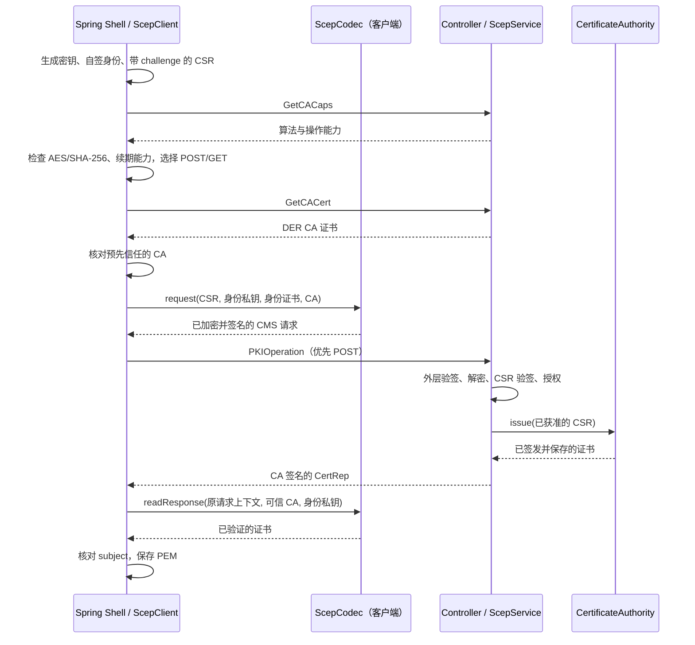

# 用这份 Java 工程学习 SCEP

CA 文件已经放在服务端 `src/main/resources/ca/`，启动时默认加载，不需要先执行 `ca-init`。建议先运行一次成功注册，再调试失败和续期。源码中的中文 Javadoc 解释职责、输入输出与校验原因；下面把这些入口串起来。

## 先掌握本工程使用的对象

| 对象 | 在 Java 中看到的类型/变量 | 本工程中解决的问题 |
|---|---|---|
| 密钥对 | `KeyPair`、`PrivateKey`、`PublicKey` | 私钥签名或解密，公钥验签或参与加密；私钥留在持有者本地 |
| CSR | `PKCS10CertificationRequest` | 申请的 subject、公钥、challenge/扩展属性，以及申请私钥做的签名 |
| 证书 | `X509Certificate` | CA 签署的身份、公钥、有效期和用途等信息 |
| 签名消息 | `CMSSignedData` | 绑定正文摘要、SCEP 属性及发送方签名 |
| 加密信封 | `CMSEnvelopedData` | 用对称密钥保护正文，再把内容密钥包装给接收者 |
| ASN.1 / DER | `ASN1ObjectIdentifier`、`DERPrintableString` 等 | 跨语言的数据类型和二进制编码；相同文本用错 ASN.1 类型也会不兼容 |
| PEM | `PemFiles` 输出的文本 | 便于保存的 Base64 包装，不是加密 |

类型介绍对应本项目的实际用法。协议原文可对照 [RFC 8894 §3](https://www.rfc-editor.org/rfc/rfc8894.html#section-3)。

## 按这个顺序读源码

1. **[ScepService.handle](../scep-server/src/main/java/com/example/scep/server/service/ScepService.java)**：先看完整处理顺序，暂时不展开每一个 BC 调用。
2. **[ScepCodec](../scep-common/src/main/java/com/example/scep/common/protocol/ScepCodec.java)**：对照类注释里的消息层次，从 `request`、`decodeRequest`、`success`、`readResponse` 四个入口阅读。
3. **[CertificateAuthority.issue](../scep-server/src/main/java/com/example/scep/server/ca/CertificateAuthority.java)**：看服务怎样把已获准的 CSR 变成固定权限的终端证书。
4. **[EnrollmentService.enroll](../scep-client/src/main/java/com/example/scep/client/service/EnrollmentService.java)**：看 CSR、公钥、临时自签身份和旧身份的来源。
5. **[ScepController](../scep-server/src/main/java/com/example/scep/server/web/ScepController.java)**：看 HTTP GET/POST、Base64、MIME 和大小限制怎样接入同一协议服务。
6. **[ScepServiceTest](../scep-server/src/test/java/com/example/scep/server/ScepServiceTest.java)**：把每个测试当作一条可调试的协议规则。测试方法前标注了要证明什么。

## HTTP 入口怎样分工

`ScepController` 使用同一个 `/scep` 地址，Spring MVC 按 HTTP 方法和 `operation` 参数选择处理方法：

| 请求 | Java 方法 | 传输层职责 |
|---|---|---|
| `GET /scep?operation=GetCACaps` | `getCaCapabilities` | 返回换行分隔的能力文本 |
| `GET /scep?operation=GetCACert` | `getCaCertificate` | 返回单张 CA 的 DER 证书 |
| `GET /scep?operation=PKIOperation&message=…` | `pkiOperationGet` | 校验 message 唯一性及编码长度，解码 Base64 |
| `POST /scep?operation=PKIOperation` | `pkiOperationPost` | 校验媒体类型和声明长度，有界读取原始 CMS 字节 |

GET/POST 的报文最终都进入私有方法 `processPkiMessage`：复核实际大小、拒绝空报文，再调用 `ScepService.handle`。注册还是续期由 CMS 内经过签名保护的 `messageType` 决定；CSR 校验、身份授权和签发仍由服务层负责。

`params` 注解负责选中入口，但不保证参数只出现一次，因此每个入口都检查 `operation` 唯一性。`unsupportedOperation` 只承接未匹配的 GET/POST，返回缺失操作、未知操作或错误 HTTP 方法的中文错误，不参与签发。路由注解要求编译期常量，所以操作字符串与 `OperationEnum` 共用 `ScepConstants` 的定义。

无法解析报文或无法取得必要响应字段时返回 HTTP 400。CMS 签名或正文摘要校验失败、外层算法不支持时，如果仍能关联事务，就和签发授权被拒绝一样返回 HTTP 200 和可验签的 `CertRep FAILURE`。内部处理故障返回 HTTP 500。POST 保留 `application/octet-stream` 及缺省 Content-Type 的旧客户端兼容，有界读取也适用于 chunked 请求。

调试 HTTP 路由可运行 `ScepHttpTest`，其中 `preservesOperationErrors` 检查缺失、重复、未知参数，`checksGetSizeBeforeAndAfterBase64Decoding` 展示编码长度与真实字节长度的区别。`keepsSignedFailureAsSuccessfulHttpResponse` 和 `returnsSignedBadMessageCheckForInvalidSignature` 分别验证授权拒绝和 CMS 签名失败的 GET/POST 协议响应。

## 一次初始注册的调用链



客户端会先查询 `GetCACaps`。现代算法下限固定为 AES/SHA-256；若服务只支持旧算法就明确拒绝，而不是退回单 DES。`CaCapabilities` 中可以观察大小写、CRLF/LF、未知能力和 SCEPStandard 的解析；续期还要求服务显式宣告 Renewal。

## 调试时区分三个字段

| 字段 | 位置 | 示例 | 处理者 |
|---|---|---|---|
| `operation` | HTTP 查询参数 | `GetCACert`、`PKIOperation` | `ScepController` |
| `messageType` | CMS 签名属性，PrintableString | `19` 注册、`17` 续期、`3` 响应 | `ScepCodec` / `ScepService` |
| `pkiStatus` | 响应的 CMS 签名属性，PrintableString | `0` 成功、`2` 失败 | 客户端 `readResponse` |

HTTP 200 可能携带 `pkiStatus=2` 的拒绝结果。`failInfo` 再描述具体原因：`0` 是 badAlg，`1` 是 CMS 完整性校验失败，`2` 是交易或业务策略拒绝，`4` 是找不到匹配证书。`failInfo=2` 与 `pkiStatus=2` 的数值恰好相同，但属于不同字段；客户端不能只看 HTTP 200 或只看一个数字。

`transactionID` 关联一次协议事务，不是证书序列号，也不授权签发。请求的 `senderNonce` 必须是 16 字节随机值，响应必须用 `recipientNonce` 回显请求 nonce，并携带一个新的 16 字节 `senderNonce`；客户端会拒绝缺失、长度错误或复用请求 nonce 的响应。当前工程没有持久化事务去重，不会因为用了 nonce 就自动避免服务端重复签发。

`CertRep FAILURE` 和 `PENDING` 的外层 `pkcsPKIEnvelope` 必须省略。这里“省略”指 CMS 的 `eContent` 不存在，带有长度为 0 的空内容也不符合要求；客户端在读取状态后先检查这一结构，再报告失败或待审批状态。成功响应则必须有非空的加密内容，内容解密后才是退化的证书包。

## 为什么要验两次签名

在 `ScepService.handle` 中，第一个验签入口是 `decodeRequest`，验证外层 CMS 与签名属性；第二个是 `csr.isSignatureValid(...)`，验证申请公钥对应的私钥证明。

初始注册还没有正式证书，客户端使用临时自签身份。任何人都可以创建自己的自签证书，因此外层验签成功后仍要检查 challenge。当前实现的静态口令只是一种简单策略；它本身没有把 subject 绑定到设备清单。

换钥续期更能说明两次签名的区别：

| 用途 | 使用的密钥 |
|---|---|
| 签署新 CSR | 新私钥，证明持有申请公钥对应的私钥 |
| 签署外层 CMS | 旧私钥，让 CA 使用已签发旧证书验证提交者 |
| 加密成功响应 | 旧证书公钥，即原请求签名者的公钥 |
| 解密成功响应 | 旧私钥 |
| 新证书内的公钥 | 新公钥 |

可在 `renewsWithOldCertificateAndNewKeyWithoutChallenge` 中观察这一过程。完整协议背景见 [RFC 8894 §2.3](https://www.rfc-editor.org/rfc/rfc8894.html#section-2.3)。

## 建议单步调试的测试

```bash
# 先看成功注册
mvn -pl scep-server -am -Dsurefire.failIfNoSpecifiedTests=false '-Dtest=ScepServiceTest#enrollsAndPersistsAnEndEntityCertificate' test

# 再看旧身份如何申请新密钥
mvn -pl scep-server -am -Dsurefire.failIfNoSpecifiedTests=false '-Dtest=ScepServiceTest#renewsWithOldCertificateAndNewKeyWithoutChallenge' test

# 最后看签名通过但授权失败
mvn -pl scep-server -am -Dsurefire.failIfNoSpecifiedTests=false '-Dtest=ScepServiceTest#wrongChallengeReturnsSignedFailureWithoutIssuing' test
```

在 IDE 中直接调试同名测试更容易观察对象。推荐断点：`ScepCodec.decodeRequest`、`ScepService.handle`、`CertificateAuthority.issue`、`ScepCodec.readResponse`。观察 `message.type()`、CSR 公钥、签名者证书、响应 `senderNonce/recipientNonce` 和 `contentPresent` 即可，不要把私钥或 challenge 输出到日志。

## 协议机制与本项目策略

CMS 封装、SCEP 属性和请求响应关系属于协议机制。固定 clientAuth 证书、RSA 2048..8192 位、SAN 默认拒绝、续期前 14 天窗口、同 subject/SAN、查询本地 issued 记录，是当前工程选择的策略。

HTTP 层兼容使用 `application/octet-stream` 或省略 Content-Type 的客户端；初始自签身份的 subject 可与 CSR 不同，但公钥必须一致，最终证书的 subject 仍来自获准的 CSR。单 DES 已永久禁止，跨实现互通验证使用 AES。掌握这些区别后，才能判断下一步接入的是协议功能、业务授权策略，还是特定设备的兼容行为。

## 源码阅读约定

本工程使用显式 Java 类型，不使用 `var`。`if`、`else` 和循环体使用大括号，判断、执行语句、结束括号分别排版，即使分支只有一条 `throw` 或 `return` 也如此。

方法内的 `//` 注释重点说明当前数据处于哪一层、使用谁的密钥、为什么要执行校验，以及失败后由哪一层处理。阅读 `ScepCodec.verify` 时，可以依次观察 CMS 解析、签名者选择、证书匹配、验签和 signedAttrs 检查；阅读 `readResponse` 时，按注释中的步骤检查响应身份、事务关联、状态、解密和证书。换钥续期的密钥区别还可对照测试 `renewsWithOldCertificateAndNewKeyWithoutChallenge` 中的行内注释。

## 从命令行进入协议

`ScepClientProperties` 将客户端 YAML 的 `scep.client` 绑定成不可变配置对象，`ClientCommands` 通过构造器接收它。`@Command` 注册命令，`@Option` 声明选项名称和 Java 类型；默认值统一来自 YAML，显式 CLI 参数优先，必需材料在合并后检查，所以续期可以只输入 `renew`。

这些数据对象是普通类。`@Value` 是 Lombok 注解，用于生成构造器、只读访问方法及值比较方法；`@Accessors(fluent = true)` 保留 `url()` 等短名称访问方法。自定义构造器中的校验不会交给 Lombok 替代；`Request.encoded()` / `nonce()` 仍显式返回数组副本。`ClientCommands` 的 `@RequiredArgsConstructor` 为 final 配置字段生成注入构造器。

`enroll` 仅处理初始注册，`renew` 仅处理续期，两者共用 `EnrollmentService`。工作流接收类型明确的 `EnrollmentOptions` 及独立的注册口令参数，不直接读取环境变量；YAML 中的 `${SCEP_CHALLENGE:}` 由 Spring 解析。注册使用 `key/out`，续期使用 `renew-key/renew-out`，旧身份仍来自 `renew-from/signing-key`。common 中唯一的 `common.shell.ShellConfiguration` 由两个应用显式导入，交给框架解析、绑定和执行命令，额外注册 `String → Path` 转换器，并拒绝重复或未知选项。

`ScepApplication` 选择 HTTP 或管理模式；HTTP 模式由 `ScepServerConfiguration` 从配置的 classpath 资源流读取 CA 并装配签发服务。`ca-init`、`shell` 管理模式不加载已有 CA，因此能够从空目录开始初始化。common 的协议与密码工具不依赖 Spring，调试协议时可直接调用 `ScepCodec`；只有共享 Shell 配置需要框架，相关依赖标记为 optional。

CMS 验签失败时，服务端只将结构合法的 `transactionID` 与 `senderNonce` 用于关联失败响应，请求随即结束。只有验签通过的请求才会进入 CSR 解密、授权和签发流程。客户端先用受信 CA 验证响应签名，再核对事务与 nonce，随后按 `failInfo` 抛出 `ScepFailureException`。

响应自带的 `certificates` 集合不是信任根。客户端用预配 CA 匹配 SignerIdentifier，然后验证签名，因此响应可省略 CA；服务端没有预配每台设备的初始身份，请求仍需携带签名证书。可分别调试 `acceptsResponseWithoutEmbeddedCa`、`acceptsSignedFailureWithoutEmbeddedCa` 和 `rejectsRequestWithoutIdentity`。

## CA 文件为什么不需要 init

SCEP 使用已有 CA 的证书加密请求、验证响应，服务端使用对应私钥解密和签发。`ca-init` 只是本工程提供的材料生成工具，不是协议步骤。已有 `ca.pem`、`ca.key` 时直接加载即可。

当前资源加载路径：`ScepProperties` 绑定 `Resource` → `ScepServerConfiguration.certificateAuthority` 调用 `getInputStream()` → `PemFiles` 解析 PEM → `CertificateAuthority.load` 检查有效期、用途与密钥匹配。不能调用 `Resource.getFile()`，因为 JAR 内的资源并不是独立磁盘文件。

资源中的 CA 不随每次启动变化；运行期间新签发的证书写到外部 `depot/issued`。这样既能从 JAR 读取静态材料，也能持久化后续续期授权所需的签发记录。内置私钥是公开的教学材料，实际 CA 需替换为自己持有的文件。
