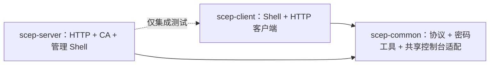

# 三模块与 Spring Shell 设计（2026-11-22）

用户确认拆分 common/client/server，并要求同时支持 Spring Shell。本次直接在现有工程迁移，保留 Java 17、中文教学注释、显式类型及完整控制语句格式。

## 依赖与启动

common 的协议、密码工具和 Console I/O 不依赖 Spring。双端共用的 `common.shell.ShellConfiguration` 使用 Spring，通过两个启动类的 `@Import` 显式导入；相关 Spring Boot / Shell Core 依赖设为 optional，不会传递给只引用协议库的使用者。共享配置默认关闭 runner，由客户端和服务端管理入口显式开启，HTTP 服务不会进入交互循环。

Console I/O 通过一个 Java 函数接口调用框架执行器，只负责一行输入、argv 引号保护、中文错误与退出码。命令参数转换、校验与执行逻辑只有一份；两个应用各自保留命令定义和启动方式，业务代码不依赖对方。

Spring Boot 的 ApplicationRunner 适合执行启动任务；ApplicationArguments 只提供原始参数和简单选项访问。Spring Shell 增加命令注册、选项类型、帮助与命令执行。当前采用 Shell 4 的 `@Command` / `@Option`，实际使用其 CommandRegistry、DefaultCommandParser、CommandExecutor。

默认 NonInteractiveShellRunner 会将 argv 直接按空格拼接，且部分解析错误只记录日志。本工程改用自己的 ApplicationRunner，保留含空格/引号/反斜杠的参数边界，并把失败返回为非零进程退出码。基础文本交互支持标准输入管道；未启用 JLine 补全/历史。这里没有再实现业务命令解析器。

## 客户端配置注入

配置与协议数据类型均使用普通 Java 类。Lombok `@Value` 简化不可变字段的构造和访问方法，`@Accessors(fluent = true)` 保留现有方法名；有校验的构造器仍手写。根 POM 统一管理编译期 Lombok 和注解处理器，可执行包明确排除 Lombok。两个配置类的 challenge 字段都排除在自动生成的 toString 之外。

`ScepClientProperties` 通过 `@ConfigurationProperties(prefix = "scep.client")` 绑定 YAML，并由客户端入口的 `@EnableConfigurationProperties` 注册。`ClientCommands` 使用构造器注入；省略的命令选项从配置读取，显式参数只覆盖本次操作，不修改配置对象。注册的 `key/out` 与续期的 `renew-key/renew-out` 分开，旧身份由 `renew-from/signing-key` 指定。

客户端的 `@Option` 不再重复声明默认值，也不强制要求每次在命令行写出续期参数。合并 YAML 与 CLI 后检查必要材料，缺少旧身份不能被误当成初始注册。`EnrollmentService.enroll(options, challenge)` 显式接收注册口令，业务工作流不读取环境变量；YAML 的 `${SCEP_CHALLENGE:}` 保留环境变量兼容，续期不使用口令。

独立部署可通过 `SPRING_CONFIG_ADDITIONAL_LOCATION=file:/绝对路径/client.yml` 加载外部 YAML。相对文件路径基于进程工作目录；默认 CA 路径指向项目内的教学 CA，部署时按实际可信材料配置。

## 协议修复

1. 删除单 DES 开关及支持路径，保留 AES 和 DES3 输入、现代算法输出。
2. 响应按 SID 使用预配 CA 验签，可省略网络报文中的 CA；请求必须自带身份凭证。
3. 查询 GetCACaps 并解析大小写、换行、未知能力和 SCEPStandard；检查现代算法与 Renewal，选择 POST/GET。
4. 双向校验 encryptedContentInfo.contentType；成功证书包检查无正文、无 signerInfo 和 id-data。

回归先用独立 BC 夹具复现，再修改生产代码。模块迁移后继续运行真实密码测试、HTTP 测试、Shell 参数绑定测试和实际 JAR 互通。

## 中文异常

应用显式异常均为中文。UserMessages 解开 Spring 反射异常，优先展示应用中文消息；文件缺失、数字转换、证书有效期等第三方异常有中文提示，不把原始底层消息直接输出到 CLI。HTTP 全局处理保留状态码与必要响应头，不外泄内部堆栈。

协议失败码、OID 和算法标识维持原定义；第三方 cause 与框架诊断日志保留原始信息供调试。业务拒绝的 HTTP 200 + CertRep FAILURE 不经过 HTTP 全局异常转换。

## 迁移注意

旧的 `target/scep-java-1.0.0.jar` 不再使用。两个应用的可执行产物分别位于模块 target 下，文件名带 `-exec.jar`；普通 JAR 可用于 Maven 引用。客户端只保留 `enroll` 注册、`renew` 续期两个业务入口，不再提供旧 `client` 别名，也不再通过 `enroll` 接受 `--renew-from` 或 `--signing-key`。续期脚本已改用 `renew`，可通过 YAML 或命令参数提供旧身份、申请密钥与输出文件；底层继续共用同一套申请流程。

单 DES 环境变量已经移除，不存在兼容模式。Go 互通脚本需要 AES 适配版参考客户端。历史验证记录中的 DES 开关只描述当时状态，不能作为当前启动方法。

协议依据：[RFC 8894](https://www.rfc-editor.org/rfc/rfc8894.html)。Shell 注解依据：[Spring Shell 命令注册](https://docs.spring.io/spring-shell/reference/commands/registration.html)；参数转换及 runner 行为核对了 Maven Central 的 4.0.4 sources JAR。

## CA 资源加载调整

默认 CA 已改为 `scep-server/src/main/resources/ca/ca.pem` 和 `ca.key`，随 JAR 打包。服务端通过 Spring Resource 输入流读取；共用 PEM 工具仍不依赖 Spring。`depot` 现在只决定外部签发记录的位置，不能据此推断 CA 文件位置。

`ca-init` 保留为可选管理命令，生成外部 CA 后，通过 `SCEP_CA_CERTIFICATE` 与 `SCEP_CA_PRIVATE_KEY` 指向它；日常启动无需初始化。原有 HTTP 测试与 Go 互通脚本已显式配置它们自己的临时 CA，避免误用内置教学材料。

## 包边界与枚举

三个模块分别使用 `com.example.scep.common`、`com.example.scep.client`、`com.example.scep.server` 包根，不再把服务端 CA 与共用密码工具放在同一个 `crypto` 包。客户端按 `config/shell/service/transport` 分包，服务端按 `config/shell/ca/service/web` 分包；服务端入口的 `@Bean` 已移入 `ScepServerConfiguration`。

`ScepClient.enroll`、`ScepCodec.request` 的消息类型参数现在是 `MessageTypeEnum`；`ScepCodec.failure` 使用 `FailInfoEnum`。直接引用库的 Java 调用方需要同步导包和参数，命令行、YAML、HTTP 参数及线上编码保持不变。协议枚举的 `code` 明确声明线上值，禁止通过 `ordinal()` 编码。`MessageTypeEnum.UNKNOWN` 仅用于输入解析，外层签名有效的未知请求仍返回可验签的失败响应。

服务端测试统一放在 `com.example.scep.server` 中，因为这些测试共享 CA/报文夹具，并覆盖协议、客户端与 HTTP 的完整集成。不要让跨层夹具依赖生产类的包内可见实现；生产包的细分不会强制拆散同一组集成测试。
